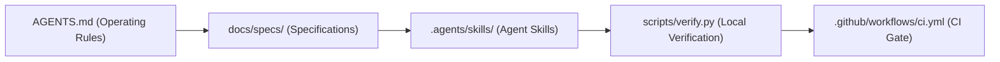

# Developer & Agent Workflow Guide

This guide describes how developers and coding agents collaborate on **Beauty Ops Copilot** using Gemini in Antigravity. It establishes a consistent, reproducible workflow based on Specification-Driven Development (SDD) and lightweight software verification.

---

## 1. System Architecture: How Rules, Skills, Specs, and CI Work Together

The repository enforces a structured lifecycle where each layer has a distinct responsibility:



- **Project Rules ([`AGENTS.md`](../AGENTS.md)):** Defines repository invariants, architectural boundaries (ADK 2.13, Gemini 3.8 Flash), safety guidelines (never commit/push without explicit authorization), and the fast verification entry point.
- **Specifications ([`docs/specs/`](specs/)):** Every functional enhancement or bugfix starts with a concise specification using [`docs/specs/TEMPLATE.md`](specs/TEMPLATE.md) before writing application code.
- **Agent Skills ([`.agents/skills/`](../.agents/skills/)):** Reusable instruction sets that guide Antigravity agents during specific lifecycle phases (e.g., investigating a test failure, reviewing an ADK tool, running verification).
- **Local Verification Script ([`scripts/verify.py`](../scripts/verify.py)):** Runs unit tests (`pytest`) and behavioral benchmarks (`run_adk_eval --offline`) locally in <10 seconds with zero cloud costs or external network requests.
- **Continuous Integration ([`.github/workflows/ci.yml`](../.github/workflows/ci.yml)):** GitHub Actions enforces the exact same verification gate on every push and pull request before code can be merged.

---

## 2. New-Developer Quickstart

To set up and verify the project locally from a fresh checkout:

```bash
# 1. Synchronize locked dependencies
uv sync --frozen

# 2. Run the canonical offline verification suite (<10s, 0 network, 0 costs)
uv run scripts/verify.py

# 3. (Optional) Run the local mock retail API and web backend
# Terminal 1: Mock inventory service
uv run python -m mock_api.stock_api --port 8001

# Terminal 2: FastAPI streaming backend & dual UI
uv run uvicorn backend.app:app --port 8000 --reload
```

Open `http://localhost:8000` to interact with Léa (B2C) and Operations Copilot (B2B).

---

## 3. The 6-Step Development Workflow

All work in this repository follows a disciplined cycle:

```
Understand ──▶ Specify ──▶ Implement ──▶ Verify ──▶ Review ──▶ Handover
```

1. **Understand:** Inspect code, tests, and active documents before making assumptions. Check current git status (`git status -s`) to preserve unrelated work.
2. **Specify:** Copy [`docs/specs/TEMPLATE.md`](specs/TEMPLATE.md) to `docs/specs/SPEC-<number>-<title>.md`. Define current behavior, proposed behavior, interface contracts, failure modes, and testable acceptance criteria.
3. **Implement:** Apply the minimal necessary diff. Respect existing patterns (Pydantic edge validation, Google ADK callbacks, scoped session state).
4. **Verify:** Execute `uv run scripts/verify.py`. Ensure all unit tests and offline ADK evals pass with zero errors.
5. **Review:** Inspect the diff (`git diff`) and verify tool safety using the `review-adk-tool` skill.
6. **Handover:** Update [`docs/PROJECT_HANDOVER.md`](PROJECT_HANDOVER.md) with verified counts, active specs, and any remaining open questions or uncertainties.

---

## 4. Skills Directory & Usage Matrix

| Skill | Path | When to Use | Output / Outcome |
|---|---|---|---|
| **`implement-spec`** | `.agents/skills/implement-spec/` | Implementing a feature or bugfix described in an approved spec | Minimal code changes adhering to contracts + regression tests |
| **`debug-failure`** | `.agents/skills/debug-failure/` | Diagnosing a failing unit test, offline eval regression, or runtime error | Root cause diagnosis + targeted fix + regression test |
| **`verify-change`** | `.agents/skills/verify-change/` | Validating changes before review or handover without editing app code | Execution of `scripts/verify.py`, diff review, git cleanliness |
| **`review-adk-tool`** | `.agents/skills/review-adk-tool/` | Auditing ADK tools (`advisor/tools.py`, `claims/tools.py`, `workspace_mcp/`) | Read-only security, typing, state scoping, and HITL audit |
| **`handover`** | `.agents/skills/handover/` | Wrapping up a session or passing the project to a collaborator/agent | Updated `PROJECT_HANDOVER.md` with verified metrics |

---

## 5. Copy-Paste Prompts & Practical Examples

Antigravity automatically discovers skills in `.agents/skills/`. You can invoke them using natural language prompts:

### A. Skill Invocation Prompts

- **`implement-spec`**:
  > *"Please implement the changes described in `docs/specs/SPEC-001-claims-hitl-lock-and-state-safety.md`. Follow the `implement-spec` skill: start by checking baseline tests, apply the minimal code change, add regression tests, and verify with `scripts/verify.py`."*

- **`debug-failure`**:
  > *"The test `tests/test_backend.py::test_chat_confirm_handles_engine_failure` is failing. Use the `debug-failure` skill to reproduce the failure in isolation, locate the root cause in `backend/app.py`, and suggest a minimal fix without weakening the test assertions."*

- **`review-adk-tool`**:
  > *"Please review the tool `create_draft` in `workspace_mcp/server.py` using the `review-adk-tool` skill. Inspect type annotations, error handling, domain allowlist enforcement, and Human-In-The-Loop safety (`require_confirmation`). Do not edit any files."*

- **`verify-change`**:
  > *"Run the `verify-change` skill. Execute `uv run scripts/verify.py`, inspect git status for unexpected modifications, and report whether all offline regression suites pass."*

- **`handover`**:
  > *"Use the `handover` skill to document our latest changes. Update `docs/PROJECT_HANDOVER.md` with the verified test count, reference active specifications, and summarize verified repository state."*

### B. Scenario Examples

#### Scenario 1: Implementing a small feature
> *"We need to add a maximum retry count to the retail stock client in `advisor/tools.py`. First draft a specification in `docs/specs/SPEC-002-retail-client-retry-limit.md` using the template. Once I approve the spec, implement the change, add a regression test in `tests/test_backend.py`, and run `uv run scripts/verify.py`."*

#### Scenario 2: Investigating a failed test
> *"I ran `uv run pytest` and got a failure in `test_scoped_state_prefixes_in_claims_tool`. Do not modify application code yet. Investigate the failure, trace the exception back to session state key handling, and explain what caused it."*

#### Scenario 3: Reviewing an ADK tool without editing
> *"Perform a read-only safety audit of `advisor/claims.py` and `claims/tools.py` using the `review-adk-tool` skill. Verify that state keys use scoped prefixes (`user:id`, `temp:`), that refunds require confirmation, and that external API calls have fallbacks. Present findings in a markdown table."*

#### Scenario 4: Verifying a change without editing application code
> *"I have staged changes in `backend/app.py`. Do not edit application or test code. Run `uv run scripts/verify.py`, check whether any evaluation assertions failed, and give me a summary of passing tests, captured warnings, and execution time."*

#### Scenario 5: Resuming work in a fresh agent session
> *"I am starting a new session. Read `AGENTS.md` and `docs/PROJECT_HANDOVER.md` to understand the current repository status. Then run `uv run scripts/verify.py` to confirm the baseline. Report what has been implemented, what is currently in progress, and what the next prioritized task is."*

---

## 6. Writing Testable Acceptance Criteria & Linking to Regression Tests

A specification is only as good as its verification criteria. Acceptance criteria must be objective, deterministic, and mapped directly to an automated test:

| Criterion Type | Example Acceptance Criterion in Spec | Direct Test Implementation in `tests/` |
|---|---|---|
| **Input Validation** | Reject empty `call_id` with HTTP 422 | `test_chat_confirm_empty_call_id_rejected_with_422` asserts `res.status_code == 422` |
| **Pydantic Model** | `ConfirmRequest` raises `ValidationError` on `call_id=""` | `test_confirm_request_validation` uses `pytest.raises(ValidationError)` |
| **Error Handling** | Engine failure emits `error` SSE event and flags KPI `failed: true` | `test_chat_confirm_handles_engine_failure` asserts `"error" in events` and `failed: true` |
| **Behavioral Gate** | Prompt injection attempt triggers Model Armor without tool calls | `evals/adk/` golden case `staff_code_social_engineering_defense` asserts 0 tool calls |

**Rule of thumb:** If an acceptance criterion cannot be asserted in Python code (`assert ...` or `pytest.raises(...)`), break it down into concrete measurable requirements before writing code.

---

## 7. Environments: Fixtures, Mocks, and Live Verification

Understanding where your code executes is essential to avoid accidental network calls, API costs, or false positives:

```
┌────────────────────────────────────────────────────────────────────────┐
│ 1. Offline Tests & Fixtures (Fast, Default)                            │
│    • Pytest unit tests (tests/test_backend.py, test_adk_eval.py)       │
│    • In-memory session service (SESSIONS=memory)                       │
│    • Local retail JSON & markdown KB files (advisor/data/)             │
│    • Execution: < 8s, 0 network, 0 cost (uv run scripts/verify.py)     │
├────────────────────────────────────────────────────────────────────────┤
│ 2. Local Mocked Services (Integration)                                 │
│    • Mock stock service: mock_api/stock_api.py on port 8001            │
│    • Workspace MCP stdio server with fixture data                      │
│    • Execution: run locally for manual web UI testing                  │
├────────────────────────────────────────────────────────────────────────┤
│ 3. Live Cloud Evaluation (Explicit, Manual Only)                       │
│    • Vertex AI Gemini 3.8 Flash (evals/adk/run_adk_eval.py --live)     │
│    • Vertex AI GenAI Evaluation Service (evals/vertex/)                │
│    • Requires GCP credentials (gcloud auth / GCP_SA_KEY)               │
│    • Triggered manually in CI via workflow_dispatch (run_live_evals)   │
└────────────────────────────────────────────────────────────────────────┘
```

> [!NOTE]
> Local development and standard CI PR gates **only execute Tier 1**. Never call paid Vertex AI APIs or external endpoints during routine local verification.

---

## 8. Definition of Done (Completion Criteria)

A task or PR is considered complete only when all of the following criteria are satisfied:

1. **Focused Diff:** Changes are minimal and strictly scoped to the specification. No unrelated files, temporary logs, or caches are modified.
2. **Offline Verification Green:** `uv run scripts/verify.py` exits with status `0` in <10 seconds.
3. **Regression Tests Added:** New behavior and edge cases have automated test coverage under `tests/`.
4. **Documentation Synchronized:** [`docs/PROJECT_HANDOVER.md`](PROJECT_HANDOVER.md) is updated with the current verification state and active specs.
5. **Clear Transparency on Residual Uncertainty:**
   - Passing tests and offline evaluations confirm that documented assertions hold, but **do not guarantee full security or production readiness**.
   - Session state prefixes (`user:id`, `temp:`) namespace session storage, but **do not replace identity validation, RBAC, or server-side authorization checks**.
   - Any unverified edge cases or production gaps must be explicitly logged in [`docs/RELIABILITY_BACKLOG.md`](RELIABILITY_BACKLOG.md).

