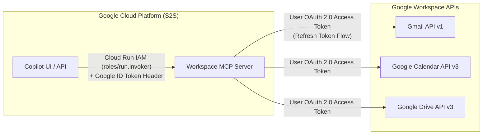

# Google Workspace Live Integration Roadmap (Option B)

This document specifies the target architecture, configuration requirements, security model, and implementation guide for **Option B: Live Google Workspace OAuth 2.0 Integration**, building upon the verified **Option A (MCP Contract Adapter)** already active in Beauty Ops Copilot.

---

## 1. Architectural Distinction: Cloud IAM vs. User OAuth 2.0

A critical enterprise architectural distinction exists between service-level identity and user-level authorization:



1. **Service-to-Service (S2S) Cloud IAM**: Authenticates the Copilot backend to the Cloud Run hosted MCP server using Google-signed OpenID Connect (OIDC) ID tokens (`roles/run.invoker`, `audience=https://workspace-mcp-...`).
2. **User OAuth 2.0 Delegation**: Grants the MCP server permission to read and create drafts on behalf of the signed-in user in Gmail, Calendar, and Drive.

---

## 2. Minimum Required OAuth 2.0 Scopes (Least Privilege)

In compliance with enterprise security baselines, write access is restricted exclusively to **drafts** (`gmail.compose`). Direct sending (`gmail.send` or `mail.google.com`) is strictly prohibited.

| Operation | Google API | Minimum Required Scope | Justification |
| :--- | :--- | :--- | :--- |
| `search_mail` | Gmail API v1 | `https://www.googleapis.com/auth/gmail.readonly` | Read-only search across subject, body, and sender headers. |
| `create_draft` | Gmail API v1 | `https://www.googleapis.com/auth/gmail.compose` | Can create and edit email drafts; **cannot send emails**. |
| `list_events` | Calendar API v3 | `https://www.googleapis.com/auth/calendar.events.readonly` | Read-only listing of user calendar events. |
| `search_files` | Drive API v3 | `https://www.googleapis.com/auth/drive.metadata.readonly` | Read-only search over document metadata and file titles. |

---

## 3. Configuration & Secrets Specification

### Environment Variables

| Variable | Description | Default (Option A) | Option B (Live) |
| :--- | :--- | :--- | :--- |
| `WORKSPACE_MODE` | Runtime execution mode | `mock` | `live` |
| `WORKSPACE_MCP_URL` | Endpoint of the Workspace MCP server | `http://127.0.0.1:8080/mcp` | Cloud Run Service URL |
| `GOOGLE_WORKSPACE_CLIENT_ID` | OAuth 2.0 Client ID | *(none)* | `xxx.apps.googleusercontent.com` |
| `GOOGLE_WORKSPACE_CLIENT_SECRET` | OAuth 2.0 Client Secret | *(none)* | Secret Manager / Env |
| `GOOGLE_WORKSPACE_REFRESH_TOKEN` | Stored offline refresh token for user | *(none)* | Secret Manager |

> [!CAUTION]
> **Zero Credentials in Git**: Never commit client secrets or refresh tokens. In local development, use untracked `.env.secrets` (listed in `.gitignore`). In Google Cloud Run, mount credentials directly from **Google Secret Manager** (`/secrets/google-workspace-oauth`).

---

## 4. Implementation Design: Adapter Pattern in `workspace_mcp/`

When activating `WORKSPACE_MODE=live`, `workspace_mcp/server.py` switches from local fixture resolution to the Google API Python client:

```python
import os
from google.oauth2.credentials import Credentials
from googleapiclient.discovery import build

def get_workspace_services():
    mode = os.getenv("WORKSPACE_MODE", "mock")
    if mode != "live":
        return None, None, None

    creds = Credentials(
        token=None,
        refresh_token=os.environ["GOOGLE_WORKSPACE_REFRESH_TOKEN"],
        token_uri="https://oauth2.googleapis.com/token",
        client_id=os.environ["GOOGLE_WORKSPACE_CLIENT_ID"],
        client_secret=os.environ["GOOGLE_WORKSPACE_CLIENT_SECRET"],
        scopes=[
            "https://www.googleapis.com/auth/gmail.readonly",
            "https://www.googleapis.com/auth/gmail.compose",
            "https://www.googleapis.com/auth/calendar.events.readonly",
            "https://www.googleapis.com/auth/drive.metadata.readonly",
        ]
    )
    gmail_service = build("gmail", "v1", credentials=creds)
    calendar_service = build("calendar", "v3", credentials=creds)
    drive_service = build("drive", "v3", credentials=creds)
    return gmail_service, calendar_service, drive_service
```

### Live Tool Mapping Examples

1. **`search_mail(query, top)`**:
   ```python
   res = gmail_service.users().messages().list(userId="me", q=query, maxResults=top).execute()
   ```
2. **`create_draft(to, subject, body)`**:
   ```python
   from email.message import EmailMessage
   import base64

   msg = EmailMessage()
   msg.set_content(body)
   msg["To"] = ", ".join(to)
   msg["Subject"] = subject
   raw = base64.urlsafe_b64encode(msg.as_bytes()).decode()

   draft = gmail_service.users().drafts().create(userId="me", body={"message": {"raw": raw}}).execute()
   draft_id = draft["id"]
   web_link = f"https://mail.google.com/mail/u/0/#drafts/{draft_id}"
   ```

---

## 5. Error Semantics & Offline Safety Rules

1. **Explicit Error Propagation**: If a live Google API call fails (network timeout, rate limit 429, revoked OAuth token), the server **must not** silently fall back to fixture data. Doing so would mislead human reviewers. The server must return:
   ```json
   {
     "status": "error",
     "error_code": "google_api_error",
     "error_message": "Google Workspace API returned 401 Unauthorized: token revoked"
   }
   ```
2. **Deterministic Offline Tests**: Offline CI gates (`pytest`, `run_adk_eval --offline`) must always force `WORKSPACE_MODE=mock` to ensure 100% reproducible execution without external network access or secrets.

---

## 6. Verification & Step-by-Step Testing Procedure

Once GCP credentials are provisioned:

1. **Export Credentials**:
   ```bash
   export WORKSPACE_MODE=live
   export GOOGLE_WORKSPACE_CLIENT_ID="<client-id>.apps.googleusercontent.com"
   export GOOGLE_WORKSPACE_CLIENT_SECRET="<secret>"
   export GOOGLE_WORKSPACE_REFRESH_TOKEN="<refresh-token>"
   ```

2. **Run Local Server Verification**:
   ```bash
   uv run python -m workspace_mcp.server
   ```

3. **Verify Tool Call Interactively**:
   ```bash
   # Test Gmail search
   uv run python -c "
   import workspace_mcp.server as srv
   from mcp.server.auth.provider import AccessToken
   srv.get_access_token = lambda: AccessToken(token='t', client_id='c', scopes=['https://www.googleapis.com/auth/gmail.readonly'])
   print(srv.search_mail('steerco'))
   "
   ```

