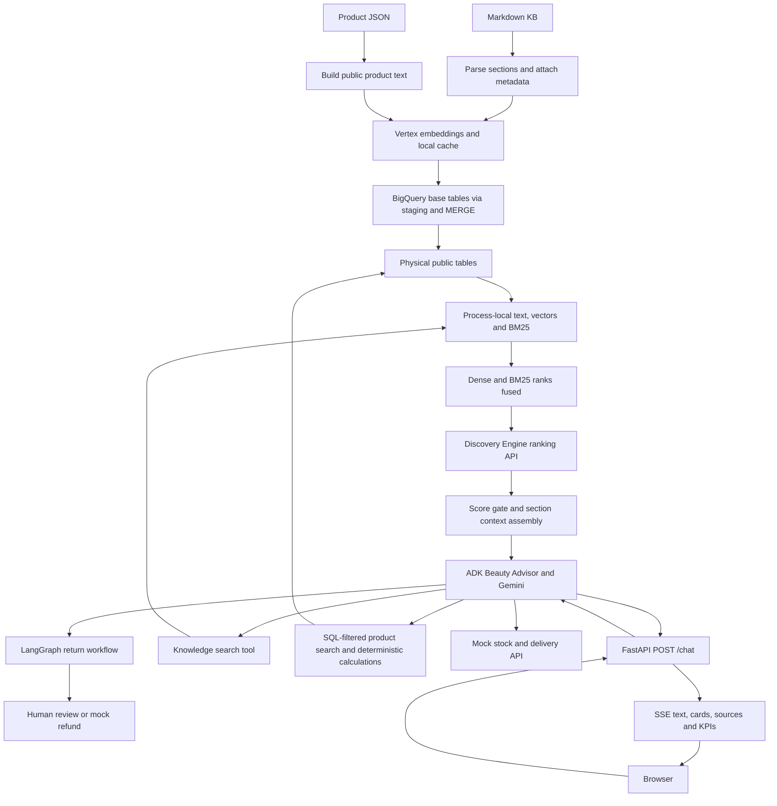

# Project handover

Verified on 2026-11-11 against working tree based on `935be48`. Initial assessment inspected code/tests/stored
results without cloud calls; continuation then ran seven live Promptfoo cases through the user's local backend
and its configured model/retrieval services. No ingestion or deployment was performed. At initial inspection,
no applicable repository/ancestor `AGENTS.md`, project `SKILL.md`, or tracked CI workflow existed. Existing claims,
backend, agent, mock API, dependency and test changes were preserved and grouped into subject-specific local
commits. GitHub Actions was added in continuation; no commits were pushed. The README mostly describes the older copilot.

Planning authority is now **[LAB_PLAN.md](LAB_PLAN.md)**, based on the user's supplied agreed schedule and previous
assistant's handoff. This is interview preparation for Friday 2026-11-13, with one preparation day remaining, not
a production project. Continue that sequence; the engineering backlog below is discussion material rather than
the immediate build plan. The older external plan referenced by README was not found locally. Branding
neutralization is authorized; GCP tracing is chosen instead of adding Langfuse. Keep the opportunity confidential.

## What exists

- **Implemented:** Beauty Advisor, a single Google ADK agent with nine tools, FastAPI/SSE chat UI, SQLite chat
  sessions, product cards/comparison/quantity calculations, knowledge retrieval with citations, mock stock/delivery
  API, feedback/KPIs, and offline/cloud evaluation harnesses. Corpus: **40 products, 26 Markdown files, 69 chunks;
  59 current public non-review advice chunks**. These counts came from local sources, not live BigQuery.
- **Implemented separately:** `copilot/` routes internal requests to M365/catalog agents, with MCP authentication,
  code-enforced governance and draft confirmation. This plugin is **not attached to Beauty Advisor**.
- **Implemented working-tree addition:** `claims/` uses LangGraph, SQLite checkpoints, deterministic return rules,
  optional LLM triage, human interrupts and refund retries. Local bus and mocked refunds pass tests; a Pub/Sub
  publisher/worker exists. The supplied prior run logs demonstrate live Pub/Sub resumption and failure/recovery;
  read-only local checkpoint inspection confirms both example claims finished refunded. Codex did not repeat
  cloud delivery; concurrent idempotency and infrastructure remain unverified.
  LangGraph is a claims workflow here, **not a second chat engine** (`backend/app.py:52`, `backend/engines.py:31`).
- **Partial/demo:** M365 and retail data are fixtures; human handoff creates a ticket-shaped response only
  (`advisor/tools.py:313`), with no queue, persistence or actual human notification. Claims photo input is a boolean,
  not an uploaded/verified photograph. Advisor endpoints have no customer/reviewer authentication.
- **Added in continuation:** `/chat/sync` buffers the existing streaming path (`backend/app.py:171`); Promptfoo
  HTTP suite and GitHub Actions configuration exist (`evals/promptfoo/`, `.github/workflows/ci.yml`). Python suite **92 passed**,
  Node assertion regressions **10 passed**, real HTTP fixture smoke **7/7 passed**. The Actions workflow passed
  `actionlint 1.7.12`; the evaluation YAML parsed locally. The CI fixture step also passed locally after migration.
  Fixture smoke uses no cloud/model calls. Subsequent live suite: original checks **7/7**, then strengthened offline
  rescoring **6/7** after manual review caught an off-topic answer. The automatic **CI gate** runs Python/Node tests
  and fixture HTTP evaluations on PRs/pushes to master; live evaluations are manual. Remote Actions execution and
  branch-protection settings remain unverified. The old untracked GitLab draft was removed before committing.
- **Planned/unknown:** advisor deployment, public-table-only runtime IAM, automatic index refresh, real
  Graph/retail integrations, production sessions, freshness alerts and operational SLOs. Terraform and Dockerfiles
  target the original copilot/MCP pair; their live state was not checked.

## Verified architecture



RAG means retrieving evidence before generating an answer. Here it is **agentic**: the language model chooses a
tool and rewrites its query; a greeting need not retrieve anything. It is not one compulsory retrieval per turn.

| Stage, input → output | Actual implementation | Choice and consequence |
|---|---|---|
| Source parsing: files → metadata/body | `advisor/chunking.py:57` `parse_doc`; `:103` `load_kb`; `advisor/data/` | Small custom front-matter parser and `*.md` discovery; no PDF parser, OCR, HTML cleaning or external source connector. Metadata defaults public/current: validate before expanding the corpus. |
| Chunking: document → `Chunk` records | `advisor/chunking.py:71` `split_long`, `:86` `chunk_doc` | One `##` section per chunk, nominal 220-word cap, paragraph splits with last-sentence overlap; title/section prefixed for indexing. A single oversized paragraph can exceed the cap. Words are not model tokens. |
| Identity/dedup: content → stable IDs | `advisor/chunking.py:53,96`; `advisor/embeddings.py:94` | 16-hex SHA-256 prefix over doc/version/section/text; exact embedding-text duplicates share a cache entry. No fuzzy/semantic deduplication; title/visibility/status/position are absent from chunk identity. |
| Embeddings: text → normalized 768-float vector | `advisor/embeddings.py:79` `_embed_one`, `:87` `embed`; `advisor/config.py:7` | `gemini-embedding-001`; document and query task types differ. Eight indexing threads, append-only local JSONL cache keyed by model/dimension/task/text. Compact vectors save space; quality must be evaluated. Query embeddings are uncached and remote. |
| Index lifecycle: rows → warehouse/public tables | `advisor/ingest.py:89` `build_rows`, `:122` `_merge`, `:141` `rebuild_public`, `:176` `rollback`, `:186` `log_run` | Products keyed by SKU/content hash; chunks insert/delete by ID. Public tables exclude internal rows, archived advice and reviews. Each MERGE is atomic; the entire multi-table run is not. Time-travel rollback and run logging exist, not re-executed here. |
| Serving: public tables → in-memory collections | `advisor/retrieval/store.py:48–90`; `advisor/retrieval/modes.py:78` | Text, product records, vectors and BM25 load lazily once. Exact normalized-vector dot product for knowledge; no ANN index. Cheap at 59 chunks, stale until restart; no version/dimension validation. |
| Query preparation: user turn → tool query/filters | `beauty_advisor/agent.py:112–159`; `advisor/tools.py:129` | Model rephrases contextual questions, selects typed filters. Clarification rules are prompts; closed vocabulary validation is code. No dedicated query planner or deterministic multi-query decomposition. |
| Knowledge candidates: query → ranked `Result`s | `advisor/retrieval/modes.py:51,73,97`; `advisor/retrieval/bm25.py:23`; `advisor/text.py:51` | Dense = meaning similarity; BM25 = word matching with French accent/elision/plural normalization. Hybrid uses reciprocal rank fusion, sum of `1/(60+rank)`, over up to 50 per retriever. Fusion combines incompatible score scales but can promote a weaker retriever's noise. |
| Reranking/gating: 20 candidates → up to 4 passages | `advisor/retrieval/modes.py:113,143`; `advisor/tools.py:92` | Default `rerank`: authenticated Discovery Engine rank API, 10-second timeout, global location by default. Cross-encoder scores query and passage jointly. Top score below 0.30 yields `no_answer`; individual low-score passages dropped. Threshold is empirically selected, not a confidence probability. Non-rerank modes lack this score gate and can return `ok` with no passages. |
| Context: hits → section passages | `advisor/tools.py:64` `assemble_context` | Expand all pieces of each section, sort by position, dedup sections, pack within 450 words. Never truncate a passage; first passage always retained even if oversized. Overlap sentences remain duplicated after expansion. |
| Product retrieval: query/filters → cards | `advisor/tools.py:129` `search_products`; `advisor/retrieval/store.py:108` | Parameterized SQL filters before BigQuery cosine search; empty query sorts by effective price. Exact SKUs (product reference codes) boost only eligible returned hits after this milestone. Products still incur a BigQuery job per search; in-memory product vectors currently support evaluations. `total_matches` counts returned candidates (cap 50), not an unlimited SQL count. |
| Generation/citations: tool results → answer | `beauty_advisor/agent.py:112,162,183`; `advisor/retrieval/base.py:19` | Gemini via Vertex/ADK; prompt asks for facts from tool evidence and `[doc_id#section]` citations. Timeouts/retries configured for generation; KB search capped at two per turn and tool removed at exhaustion. Citations/grounding checked in eval, not validated or repaired at runtime. |
| Conversation/UI: events → rendered response | `backend/engines.py:31,54`; `backend/app.py:95`; `backend/ui_events.py:17`; `backend/static/index.html` | SQLite sessions, ADK SSE partial text, structured events; cards/prices come from tools. Earlier tool results compacted in model requests (`beauty_advisor/agent.py:80`), stored session preserved. Text usually waits for retrieval and a second model call. |
| Observability: tool/turn → spans and JSONL | `advisor/tools.py:106`; `backend/app.py:71,149`; `backend/telemetry.py:21` | Stage latency/top score/citation/abstention spans, per-turn tokens/thinking/tool timings, feedback, optional OTLP/Cloud Trace. Cost defaults to zero unless rates configured and excludes several service costs. `model_ms` is residual wall time, not direct provider timing; parallel tools make attribution approximate. |

## Concrete document and question

`advisor/data/kb/pol-retours.md:1` is public/current, version `2026-01`. `chunk_doc` makes three section chunks;
the “Produits non ouverts” chunk contains the 30-day rule. Its embedded text starts with
`Retours et remboursements > Produits non ouverts`. `build_rows` adds the vector/model/dimension/time, `_merge`
persists it, and `rebuild_public` selects it into `chunks_public`. The archived `pol-retours.v2024.md` has distinct
version-based IDs and a conflicting 21-day rule; it stays in base storage but is excluded from advice **on a fresh
build**. Deleting a source removes its chunks on the next MERGE; there is no separately retained permanent archive.

For “Combien de jours ai-je pour retourner un produit non ouvert ?”, `/chat` selects a session; ADK gives the
message, instruction, history and tool schemas to Gemini. If Gemini calls `search_knowledge`, the adapter counts
the call, then embeds the standalone query. Dense and BM25 produce candidates, RRF fuses their ranks, the rank API
rescoring selects passages, and `assemble_context` expands/deduplicates/packs them. A score below 0.30 returns no
evidence; otherwise Gemini is instructed to answer “30 jours” with `[pol-retours#Produits non ouverts]`.
The backend streams text and separately emits source metadata. This is the traced code path, **not a fresh live
Gemini run**. The fresh local BM25 example ranked this current section first (score 15.794).

For debugging, inspect in order: parsed source/version → public table contents → process cache age → candidates
and scores → assembled tool response → model answer. Good retrieval does not guarantee a grounded answer.

## Access and trust boundaries

- `rebuild_public` physically separates public advice and products. Product embedding text uses an explicit public
  field list; indexing still embeds internal documents using the ingestion identity before filtering serving rows.
  Serving code only names public tables. Actual table-level IAM is **unverified** and absent from advisor IaC.
- Reviews are stored in `reviews_public`, outside advice retrieval. This removes a planted injection from the
  candidate pool; the system prompt also treats tool content as data. There is no runtime output canary scanner
  or general guarantee that authored documents are injection-free.
- Advisor does not inherit copilot governance. It now has claim tools with write effects, so old comments/findings
  describing a read-only advisor are stale. All web sessions use `user_id="web"`; thread/claim IDs are identifiers,
  not ownership checks. Reviewer identity is supplied in the request (`backend/app.py:170–199`). Keep local demo
  scope until authentication, ownership and reviewer authorization are implemented.
- Message content is disabled in traces by default, but SQLite sessions hold conversations and feedback comments
  are logged. Retention/redaction is not implemented. Generation defaults to Vertex `eu` when configured; embeddings
  default to `europe-west1`, ranking to `global`. EU-only processing is not established for the full path.

## Setup and run commands

Requires Python >=3.12; existing `.venv` was used without dependency installation. Installed versions verified:
ADK 2.13.0, BigQuery 3.47.0, MCP 2.3.0, google-genai 2.34.0, FastAPI 0.162.0, LangGraph 1.2.20, pytest 9.2.0.
`pyproject.toml`/`uv.lock` include the user's pending claims dependencies. Do not overwrite them or the existing env.

```bash
# Actually tested, no cloud services/credentials needed:
.venv/bin/python -m pytest -q
.venv/bin/python -m advisor.ingest --help
git diff --check

# Setup/run recipes from code; NOT executed in this assessment:
uv sync --frozen
# First setup only, if copilot/.env does not already exist:
cp copilot/.env.example copilot/.env
# Edit project/model configuration locally; never commit or print credentials.
gcloud auth application-default login
uv run uvicorn mock_api.stock_api:app --host 127.0.0.1 --port 8090
uv run --env-file copilot/.env uvicorn backend.app:app --host 127.0.0.1 --port 8000
# Alternative developer UI (select beauty_advisor, copilot, or m365_only):
uv run --env-file copilot/.env adk web --reload_agents
# Original copilot also needs its MCP server:
uv run python -m m365_mcp.server
```

The env example covers the older copilot. Advisor additionally defaults `BQ_DATASET=beauty_rag`, `BQ_LOCATION=EU`,
`EMBED_MODEL=gemini-embedding-001`, `EMBED_LOCATION=europe-west1`, `EMBED_DIM=768`, `RANK_LOCATION=global`,
`KNOWLEDGE_MODE=rerank`, `RANK_MIN_SCORE=0.30`, `MAX_CONTEXT_WORDS=450`, `MAX_KB_SEARCHES_PER_TURN=2`.
`THINKING_LEVEL_ADVISOR` is unset in code (the findings say LOW was adopted, but actual local env was not read).
`SESSIONS=sqlite`, `BACKEND_DATA_DIR=.data`, `RETAIL_API_URL=http://127.0.0.1:8090`;
claims default `CLAIMS_BUS=local`, `CLAIMS_TRIAGE=llm` (`rule` for offline triage).

Cloud ingestion needs ADC, BigQuery permissions and embedding access; retrieval/generation additionally need
Discovery Engine rank and Vertex access. These recipes were **not run**:

```bash
uv run --env-file copilot/.env python -m advisor.ingest --dry-run
uv run --env-file copilot/.env python -m advisor.ingest
# Restart serving after apply to reload all collections.
```

Important: CLI `--dry-run` avoids embedding/cache writes but **still calls `create_dataset`** before planning
(`advisor/ingest.py:205–208`). It is not entirely read-only. Apply/rollback mutate cloud tables; no such operations
were performed. Dataset/model state and permissions remain unverified.

## Evaluation and observed results

**GCP tracing verified live (read-only):** Cloud Trace API returned HTTP 200 and eight recent frontend traces for
`service.name=advisor-api`, `deployment.environment=local`, correlated to `.data/kpi.jsonl` by `chat.turn_id`.
Evidence: `evals/tracing/advisor_20261111.summary.json` (IDs, links, timings and tool names, no message content).
The knowledge turn `6ecbb3d10164` has trace `d054f615fdab8485ad749a8792b8571b`: total 13.753 s, three model
spans totaling 9.729 s, two tool spans totaling 3.918 s. First retrieval 3.520 s includes lazy BigQuery loading;
second retrieval 0.398 s has vector-memory 3.6 ms and BM25 0.11 ms. RAG attributes include mode, score, citation,
abstention and stage timings. Scores 0.3338/0.4613 exceeded 0.30. Subsequent read-only inspection of the exact local
session turn confirmed the niacinamide/retinol question: retrieved hyaluronic-acid compatibility text did not
establish that pair's compatibility, and the final answer correctly acknowledged missing documentation and offered
a human advisor. Retrieval did not abstain, but the model did. The user's final model-span tool definitions omit
`search_knowledge`, confirming tool removal after two searches. Installed ADK telemetry counts reasoning within
output tokens: final span 166 output = 54 candidate + 112 reasoning tokens; backend KPIs report those separately.
The claim-opening turn took 29.672 s: model spans 27.100 s, tool 2.419 s. Generation dominates this example.
The sampled RAG trace's content-related attribute-name scan found only an invocation identifier; message values
were not printed. This is a sample check, not a comprehensive PII audit. Current spans cover the ADK tool boundary,
not individual LangGraph nodes or distributed propagation through Pub/Sub. No application code or services changed.

Continuation live evidence: the user's single `/chat/sync` policy turn returned the correct 30-day and 10-day rules
with a retrieved citation, one search, 9845 ms total and 9294 ms first text. Codex then ran seven live HTTP cases,
serially with cache disabled: original assertions passed 7/7 with zero infrastructure errors. Manual review found
Léa answered “Tokyo” before redirecting an off-topic question; the old check only required zero tools. The evaluator
now rejects that answer (10 Node regression tests pass). Offline rescoring of the SAME saved responses is **6/7**,
not a second model run. Sample turn latency median **3652 ms**, max **6068 ms**, n=7; no reliability/SLO claim.
Saved summary: `evals/promptfoo/results/live_20261111.summary.json`; raw local report:
`/private/tmp/beauty-promptfoo-live.json`. No claims were opened/refunded. Promptfoo's HTTP provider token counters
are zero; backend response metrics contain the real counts. Fix the scope instruction in the planned cleanup block.

Fresh local checks: **81 tests passed before changes; 90 passed after**, final run 2.26 seconds. Nine new cases
cover exact-reference filter enforcement, duplicates/case/unknown references, preserved dense order and ordinary/
empty-query behavior. Seven regressions failed against the old implementation before the fix. Existing tests
also exercise governance, MCP contracts, chunking, sessions/SSE with fake engine, API failures and real local
LangGraph checkpoints with mocked retail/rule triage. They do not establish live service correctness.

Fresh offline retrieval: BM25 over the 59 advice chunks, using `GOLDEN`, hit@5 **20/25 = 0.80**, MRR **0.6547**.
Hit@5 here means any labelled section is found, or all when `require_all`; it is not fractional per-document
recall. MRR is mean reciprocal rank: first place earns 1, second earns 1/2, absent earns 0. Reproduce locally:

```bash
.venv/bin/python - <<'PY'
from pathlib import Path
from advisor.chunking import load_kb
from advisor.retrieval.bm25 import BM25Index
from evals.advisor.golden import GOLDEN
from evals.advisor.metrics import recall_at_k, reciprocal_rank
cs = [c for c in load_kb(Path('advisor/data/kb'))
      if c.visibility == 'public' and c.doc_type != 'avis' and c.status == 'current']
idx = BM25Index([(c.chunk_id, c.embed_text) for c in cs])
refs = {c.chunk_id: f'{c.doc_id}#{c.section}' for c in cs}
scores = []
for g in GOLDEN:
    if g['expect']:
        got = [refs[cid] for cid, _ in idx.search(g['q'], 5)]
        scores.append((recall_at_k(got, g['expect'], 5, g.get('require_all', False)),
                       reciprocal_rank(got, g['expect'])))
print('n, hit@5, MRR:', len(scores), *(sum(s[i] for s in scores)/len(scores) for i in (0, 1)))
PY
```

Stored cloud evidence inspected, **not rerun and not a benchmark for this working tree**:

| Artifact under `evals/advisor/results/` | What it demonstrates | Limits |
|---|---|---|
| `retrieval_20261111_140457.json` | Rerank hit@5 1.00, MRR 0.98, top1 0.96 on 25 answerable/30 total; p50 346 ms, p95 428 ms; poisoned review 0/30. Earlier `135334` run had review exposure 8/30. | Warm caches, tiny authored corpus, excludes generation; predates version changes. |
| `hard_20261111_152231.json` | Combined 51 questions: dense/rerank top1 50/51, hybrid 42/51, BM25 30/51. Dense 95% interval [0.90,1.00]. | Product harness tests pure retrieval without attribute filters or the tool's SKU boost, so missed this milestone's bug. |
| `agent_20261111_162652.json`, `163508.json` | Each records all 11 cases passing, including deterministic checks and selected grounding judges. Earlier runs catch unsupported comparison benefits. | Stochastic/self-judged, limited cases; current suite now has 13 including A12 versions/A13 claims, so no full current-suite result established. |
| `agent_20261111_165031.json` | Three selected cases pass (A3/A4/A12); supports the 30-day policy/version example. | Not a complete rerun; claims addition not covered by this saved run. |

Citation checking tests whether emitted citations were retrieved, not whether every claim has a citation or the
cited text entails it. Grounding judge covers selected cases and can err. Canary matching detects planted strings,
not arbitrary disclosure. A6 no longer exercises retrieved injection when reviews are excluded. No cloud answer
quality, new latency/cost benchmark, production IAM or complete current 13-case run was verified here.

Cloud evaluation commands (ADC/services/billing required; some cases write claim state/call the configured retail
service, so use an isolated test data directory and mock API; **not executed**):

```bash
uv run --env-file copilot/.env python -m evals.advisor.run_retrieval_eval
uv run --env-file copilot/.env python -m evals.advisor.run_hard_eval
BACKEND_DATA_DIR=/tmp/beauty-eval CLAIMS_BUS=local uv run --env-file copilot/.env python -m evals.advisor.run_agent_eval --n 2
# Older copilot evaluation, separate from advisor:
M365_CONFIRM_WRITES=0 uv run --env-file copilot/.env pytest evals/test_eval_core.py -q -s
```

Default pytest only selects `tests/` (`pyproject.toml:25`), not the paid ADK test in `evals/`. Advisor eval scripts
write JSON/print failures but do not currently exit nonzero on failed quality checks; they are reports, not CI gates.

## Completed milestone and remaining backlog

**Completed:** product references respect SQL eligibility. `advisor/tools.py:157–165` now intersects reference
boosting with returned candidates and deduplicates typed references. No dependency, SQL, UI or agent prompt changes.
Regression tests: `tests/test_advisor_tools.py:23–77`. Limitation retained: a reference outside the first 50 candidates
cannot be boosted; all 40 current catalog rows fit. No claim of a retrieval/answer quality improvement beyond these
deterministic correctness checks.

**Immediate lab continuation:** GCP tracing is verified; proceed to the Model Armor experiment and then the
cleanup/French-demo blocks in `LAB_PLAN.md`.
Live `/chat/sync` + Promptfoo evidence is recorded above; preserve the off-topic failure for cleanup/retest.
See `evals/promptfoo/README.md` for
the tested offline commands and live prerequisites. The production-oriented items below are deferred unless
they block that demo. Metadata-safe ingestion remains a useful future engineering milestone, not the current plan.

| Priority / work | Evidence and benefit | Concrete acceptance criterion |
|---|---|---|
| P1: metadata-safe chunk MERGE | `chunking.py:96` omits metadata from ID; `ingest.py:225` disables chunk updates. Local public→internal edit retained the ID. Status/title/position edits likewise stay stale. | After initial ingest, public→internal and current→archived edits remove serving rows; title/position edits update rows; identical second run changes nothing. No embedding call for unchanged embed text. Add lifecycle tests and model/dimension mismatch rejection. |
| P1 before external use: ownership and reviewer authorization | `backend/engines.py:51` shares user ID; `backend/app.py:175–199` has unauthenticated review actions; claims tools have no caller ownership argument. Prevent cross-customer reads/refunds. | Unauthenticated decisions rejected; customer A cannot read/resume B's chat/claim/order; only authorized reviewer can decide; actual runtime IAM denied on internal tables. Verify with negative tests. |
| P1: consistent ingestion and serving freshness | Tables publish separately; caches never expire (`store.py:48–90`, `modes.py:78`); no dimension check. Prevent deleted/stale/conflicting evidence. | Publish/reload one coherent version; failure leaves old snapshot usable; deletion/update visible after explicit refresh; vector model/dimension mismatch fails clearly. Start with a versioned snapshot/refresh contract, no new database required. |
| P2: truly read-only planning and failure visibility | `ingest.py:208` creates dataset on dry run; broad exceptions in `_table_fields`/`plan` treat permission/network errors as missing tables. | Dry run performs zero mutation/embedding calls even on an empty project; permission/network failures fail visibly rather than suggesting a rebuild. Test with fake clients. |
| P2: meaningful evaluation gate | Hard harness bypasses production product filters; current reports exit successfully on failures; citations don't require coverage; new claims route can conflict with A4's old expected policy answer. | Production-tool filter cases, empty-corpus abstention in every mode, missing/unsupported citations, authored-source injection, version/metadata transitions and 13 current cases have clear expected behavior; failing assertions yield nonzero status. Add lightweight offline CI before paid jobs. |
| P2: honest handoff and operational accounting | Handoff tool only invents a ticket; cost defaults zero and omits embedding/ranking/warehouse/triage; local locks/state have no TTL and SQLite deployment is unspecified. | Handoff is explicitly demo-only or persisted and delivered; unconfigured cost shown as unknown; provider/service costs and retention documented; health distinguishes process liveness from unavailable dependencies. |

Resume by reading `LAB_PLAN.md` and this file, running `git status --short`, and preserving all pending work.
Continue one interview-relevant step at a time. No deployment, publish, rollback or destructive operation is
authorized by this handover.
